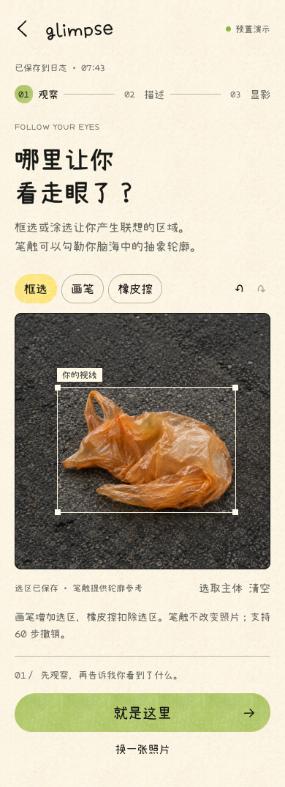
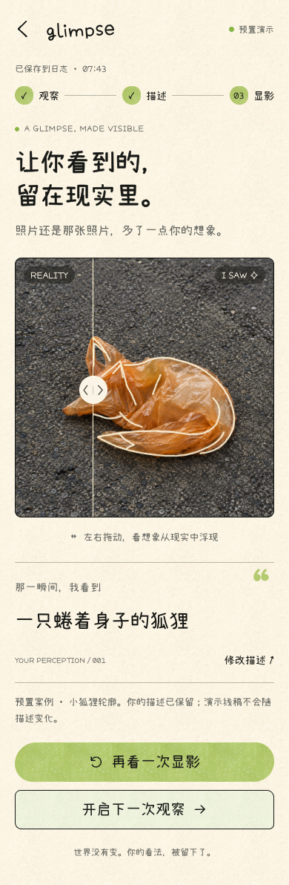

# 灵感显影 Glimpse

<p align="center"></p>
<p align="center">把你一瞬间「看错」的东西，描出来。<br>拍下日常、指出联想的位置，用原图上的 SVG 笔触留住灵感。</p>
<p align="center"><a href="https://jessica-yaoyao.github.io/Glimpse/">在线体验</a> · <a href="https://github.com/Jessica-yaoyao/Glimpse/releases/tag/v0.5.1">v0.5.1 下载</a> · <a href="#界面预览">界面预览</a> · <a href="CHANGELOG.md">迭代记录</a> · <a href="docs/VERSION_HISTORY.md">版本分支</a></p>

Glimpse 是一款 Mobile-first 的视觉联想记录工具。例如，你把路面上的塑料袋看成蜷着的狐狸，就可以选择照片中的区域、描述这个联想，再观看轮廓沿原图显现，并把它保存为带时间和地点的灵感日志。

**[打开网页版演示 →](https://jessica-yaoyao.github.io/Glimpse/)** 无需下载或 GitHub 登录，手机和电脑浏览器均可体验。显影使用 Mock，照片和日志保存在当前浏览器；Kimi 实时识别与系统地图在 macOS 应用提供。

## 快速下载

| 平台 | 下载 | 使用说明 |
| --- | --- | --- |
| macOS 13+ · Apple Silicon / Intel | [下载 v0.5.1 ZIP](https://github.com/Jessica-yaoyao/Glimpse/releases/download/v0.5.1/Glimpse-v0.5.1-macOS.zip) | 解压后打开 .app；实时识别需要自己的 Kimi Code Key |
| 网页 / 小红书 STATIC_SITE | [下载纯静态 ZIP](https://github.com/Jessica-yaoyao/Glimpse/releases/download/v0.5.1/Glimpse-v0.5.1-STATIC_SITE.zip) | 解压根目录 index.html；Mock 演示；无需后端 |

[全部版本](https://github.com/Jessica-yaoyao/Glimpse/releases) · [SHA-256 校验清单](https://github.com/Jessica-yaoyao/Glimpse/releases/download/v0.5.1/SHA256SUMS.txt) · [版本历史](docs/VERSION_HISTORY.md)

macOS 分发包使用本机测试签名，未进行 Apple Developer ID 公证。下载后可先核对校验清单；首次访问相机、定位或钥匙串时由使用者授权。

## 界面预览

截图使用示例照片或隔离 UI 数据。显影截图为明确标注的 Mock 演示；它展示交互，不代表真实模型的识别准确率。描述、显影、时间轴和月历页面复用 v0.5.0 中未变更的界面截图。

<table>
  <tr><td width="33%"></td><td width="33%"></td><td width="33%"></td></tr>
  <tr><td align="center">发现与记录</td><td align="center">精细选区</td><td align="center">描述联想</td></tr>
  <tr><td></td><td></td><td></td></tr>
  <tr><td align="center">SVG 显影 / 前后对比</td><td align="center">时间轴手账</td><td align="center">月历回看</td></tr>
</table>

## 主要功能

- 首次开屏和记录首页：真实总数、本月记录、连续天数、搜索与最近照片；可从设置重看开屏。
- 照片来源：相册、拖入与主动拍照；摄像头不可用时可继续上传。
- 完整观察流程：示例或上传照片 → 选区 → 描述 → 处理进度 → SVG stroke animation → Before/After 滑块。
- 精细选区：框选、8–48px 画笔、橡皮擦、60 步撤销／重做／清空；点和半径采用 normalized coordinates；手工笔迹带粉笔颗粒质感，实际识别 mask 仍连续。
- 保留原照片：显影以 SVG 路径覆盖原图，可重播、查看原文件和切换历史显影版本。
- 灵感日志：导入即存原文件和草稿，支持发现时间、上传时间、地点、坐标、详情编辑、时间轴与月历。
- 照片地图：macOS MapKit 用照片缩略图标记位置，支持同地聚合、按月筛选和跳转记录。没有定位也能保存灵感。
- Kimi Code：Key 输入／移除、模型选项、连接检查、真实请求回执和本机累计 Token 预算；Key 存 macOS 钥匙串。
- 质量验收：固定照片与联想任务、人工四项评分、首次成功／失败记录以及独立轮廓增强对照。

## 网页与 macOS 的能力边界

| 能力 | 网页 / STATIC_SITE | macOS 应用 |
| --- | --- | --- |
| 上传、精细选区、描述、动画与对比 | 支持 | 支持 |
| 显影内容 | MockRevealProvider：示例狐狸 / 通用实验线稿 | Kimi Code 实时请求；错误不会退回 Mock |
| 照片与日志 | 当前浏览器 IndexedDB | 本机文件仓库 |
| 地点与坐标 | 列表、手工编辑；HTTPS 可申请定位 | MapKit、选点与主动定位 |
| 系统地图、Vision 轮廓增强 | 不提供原生桥接 | 支持；增强语义质量仍待独立实测 |
| API Key | 配置界面仅保留本次内存，不能启用实时识别 | macOS Keychain |

这是可运行 MVP。既有真人 A3 结果为可用 5/20、端到端 P90 37.115 秒，尚未达到原定质量与延迟门槛；轮廓增强对照也没有完成新的真实评分。本仓库不将自动测试或预置线稿作为模型质量证明。见 [验收与限制](docs/ACCEPTANCE.md)。

## 本地开发

Node.js 22.18+（建议 24）与 pnpm 10+：

```bash
pnpm install --frozen-lockfile
pnpm dev
pnpm build
pnpm test
```

项目运行依赖只有 React 和 React DOM。Vite 开发预览使用 Mock，不发送 Kimi 请求；浏览器相机和定位需要安全上下文及用户授权。也可以使用 npm install / npm run dev，pnpm-lock.yaml 是仓库锁文件。

构建 macOS 应用（需要 macOS 与 Xcode Command Line Tools）：

```bash
bash desktop/package.sh /tmp/glimpse-build
```

应用直接加载包内网页，无需本地后端或 Node 服务。构建产物在指定目录，临时编译文件在 .build/，不写入源代码目录之外的工作区。

构建纯静态上传包：

```bash
pnpm build:static
# 输出 .build/static-site/ 与 .build/Glimpse-v0.5.1-STATIC_SITE.zip
```

部署入口为 ZIP 根目录的 index.html，所有资源使用相对引用。已有静态包可直接上传，平台无需安装依赖；详见 [静态部署](docs/STATIC_SITE.md)。

已配置 GitHub Pages，通过独立的 `gh-pages` 分支发布构建产物。源码提交后运行 `pnpm deploy:pages` 更新站点；当前不以主分支推送自动触发源码构建。详见 [Pages 发布与回滚](docs/DEPLOYMENT.md)。

## 版本与历史

本仓库从保存的本地快照恢复历史，不将导入时间冒充原始开发时间。三个版本分别用 release 分支和版本标签保留，main 跟随最新版本。

| 版本 | 分支 | 主要变化 |
| --- | --- | --- |
| [v0.4.0](https://github.com/Jessica-yaoyao/Glimpse/releases/tag/v0.4.0) | [release/0.4.0](https://github.com/Jessica-yaoyao/Glimpse/tree/release/0.4.0) | 建立奶油纸张、手写字、柔和纸块与参考插画的固定视觉系统。保留完整显影、日志、地图和评分流程。 |
| [v0.5.0](https://github.com/Jessica-yaoyao/Glimpse/releases/tag/v0.5.0) | [release/0.5.0](https://github.com/Jessica-yaoyao/Glimpse/tree/release/0.5.0) | 增加首次开屏、真实记录首页、观察页、照片来源与摄像头；补齐三款 SVG 照片框、Nice day 与 Keep going 装饰。 |
| [v0.5.1](https://github.com/Jessica-yaoyao/Glimpse/releases/tag/v0.5.1) | [release/0.5.1](https://github.com/Jessica-yaoyao/Glimpse/tree/release/0.5.1) | 精细选区采用粉笔颗粒笔迹，调整示例文案与设置位置；替换应用图标，并提供 STATIC_SITE 分发包。 |

[完整 CHANGELOG](CHANGELOG.md) · [来源与恢复说明](docs/VERSION_HISTORY.md) · [历史视觉对照](docs/visual-history.html)

## 技术与数据

React + TypeScript + Vite；macOS 使用 AppKit / WKWebView、MapKit、Vision、AVFoundation 与 Security。RevealProvider 隔离 Mock 和真实实现，所有选区坐标与画笔半径均归一化保存。没有自建后端或数据库服务。

照片、日志与坐标保存在本机；地图显示时适配 WGS-84 / GCJ-02，记录仍保存 WGS-84。真实显影只提交必要的选区裁剪、mask 和文字；轮廓增强还提交候选边缘参考。不上传整个日志或 GPS。详见 [隐私与安全](docs/PRIVACY.md)。

## 作者与素材

由 [Jessica-yaoyao](https://github.com/Jessica-yaoyao) 维护。字体 Xiaolai、小范围坐标转换算法和 Natural Earth 数据按各自许可使用，见 [第三方说明](NOTICE.md)。应用视觉素材来自项目提供的参考与图标，本仓库没有替素材权利人另行授予许可；尚未为项目代码指定新的通用许可证。

README 的组织方式参考 [ChatGPT Web Next](https://github.com/IronMan-libingxue/ChatGPT-Web-Next)，内容与能力说明按 Glimpse 的实际实现编写。
